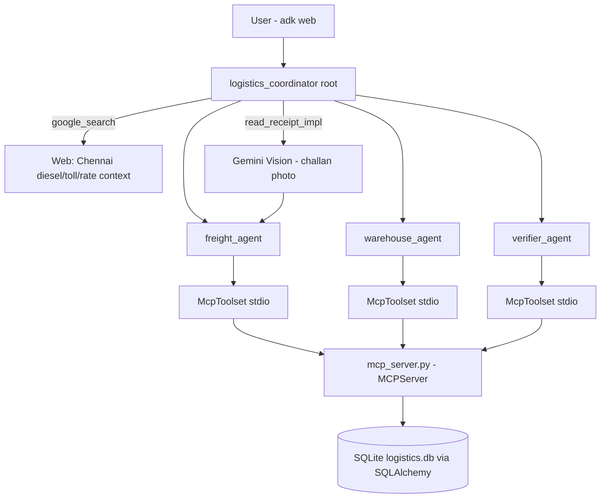

# Logistics Handler — ADK Multi-Agent Supply Chain Assistant

An agentic logistics system for the Chennai region built on Google's **Agent
Development Kit (ADK)**. A root coordinator agent routes work to specialist
agents that book freight, allocate warehouse space, and verify every booking —
backed by SQLite through a custom MCP server, with self-healing retries and
multimodal challan (receipt) reading.

## Architecture



- **root (`logistics_coordinator`)** — routes requests, owns `google_search`,
  assembles the final answer with cost + verification + self-heal count.
- **freight_agent** — searches trucks, books/cancels shipments (MCP tools).
- **warehouse_agent** — searches warehouses, allocates pallet space (MCP tools).
- **verifier_agent** — re-reads the DB after every booking; flags
  double-bookings, inconsistent truck flags, negative costs.
- **mcp_server.py** — custom MCP server (`MCPServer`, stdio) exposing all
  persistence; tools never raise raw errors, they return structured
  `{"status": "ERROR", "reason": ..., "detail": ...}` dicts.
- **db.py / seed.py** — SQLAlchemy 2.0 ORM models + idempotent Chennai seed data.

## Self-healing (required by the event brief)

| Error reason | Remediation (max `MAX_RETRIES=2`) |
|---|---|
| `capacity_exceeded` | Re-search alternative truck/warehouse, retry |
| `truck_unavailable` | Next-best truck |
| `double_book` (verifier catch) | Rollback via `cancel_shipment`, re-book |
| `not_found` | Re-check arguments once |
| `db_locked`/timeout | Retry once after `RETRY_DELAY_S` |
| unknown | Escalate to root; root reports the failure honestly |

Every remediation is recorded in the `self_heal_log` table via `log_self_heal`;
the final answer reports how many failures were auto-recovered.

## Setup & How to Run

Requires [uv](https://docs.astral.sh/uv/) on PATH and a Google AI Studio API
key (free): https://aistudio.google.com/apikey

```bash
# 1. one-time setup
uv venv .venv
uv pip install -r requirements.txt
cp .env.example .env        # paste your GOOGLE_API_KEY inside

# 2. seed the fake Chennai database (idempotent)
uv run python seed.py

# 3. run the agent UI
uv run adk web
```

Open http://127.0.0.1:8000, select **`logistics`** from the dropdown, and chat.

## Demo script

1. *"Book shipment of 4 pallets from Chennai Port to a warehouse in
   Sriperumbudur"* → warehouse allocates, freight books, verifier confirms,
   summary with truck + warehouse ids and total cost.
2. *"Read the challan at receipts/sample_challan.jpg and book that shipment"* →
   Gemini Vision extracts pallets/weight/destination, agent books end-to-end.
3. *"Truck T3 just broke down — cancel its shipments and re-book"* → agent
   cancels, re-books, and reports the auto-recovered failure count.

## Tests

```bash
uv run pytest tests/ -q
```

34 unit/integration tests: seed data, every tool success + structured error,
verifier double-book detection, self-heal fault injection, MCP stdio
handshake, mocked Gemini reception reading.

## Repo layout

```
config.py            every hardcoded/configurable value (spec §3.1)
db.py                SQLAlchemy ORM models + engine/session helpers
seed.py              idempotent seed data loader (CLI)
receipt_reader.py    Gemini Vision challan extraction (multimodal)
mcp_server.py        custom MCP server (MCPServer, stdio) over the ORM
logistics/           ADK agent package (adk web discovery)
  agent.py           root coordinator (+ google_search)
  sub_agents/        freight, warehouse, verifier specialists
scripts/             sample challan generator
tests/               pytest suite
docs/superpowers/    design spec + implementation plan
```

## Measured latency

(end-to-end demo time will be filled before submission)
