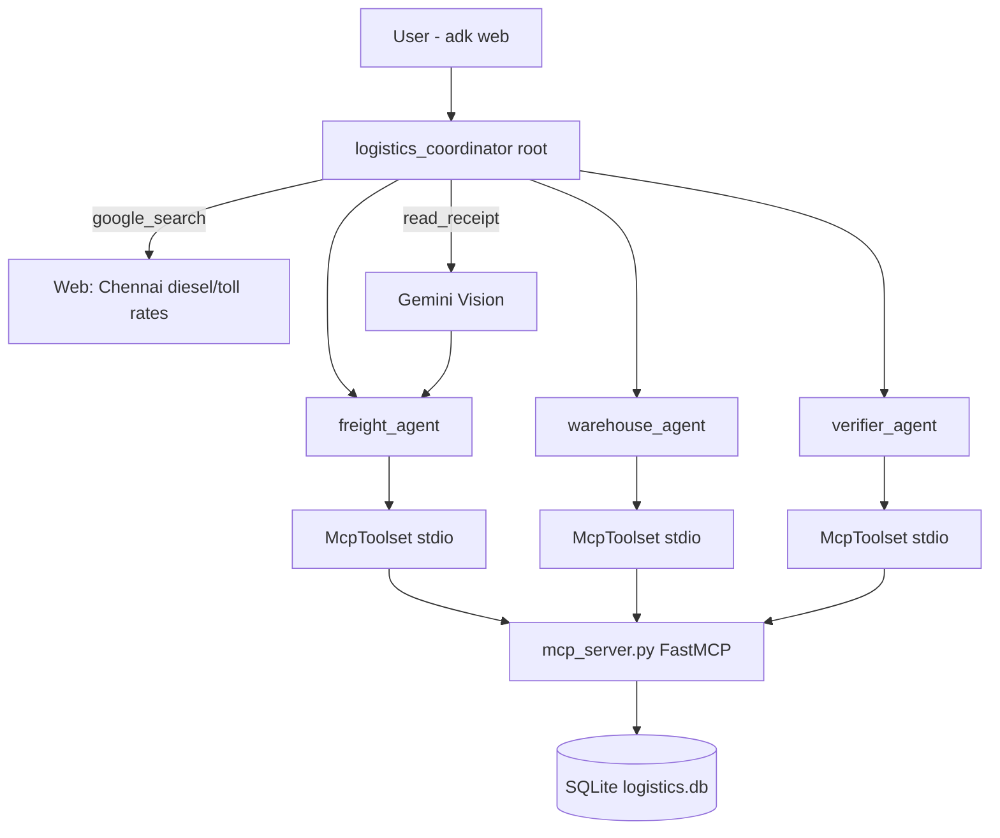

# Logistics Handler (ADK Multi-Agent) Implementation Plan

> **For agentic workers:** REQUIRED SUB-SKILL: Use superpowers:subagent-driven-development (recommended) or superpowers:executing-plans to implement this plan task-by-task. Steps use checkbox (`- [ ]`) syntax for tracking.

**Goal:** Multi-agent ADK system that books freight and allocates Chennai warehouse space from chat, with SQLite via a custom MCP server, self-healing retries, and multimodal challan reading.

**Architecture:** Root `LlmAgent` routes to three specialist `LlmAgent`s (freight, warehouse, verifier). All DB persistence goes through a custom FastMCP server (`mcp_server.py`) launched over stdio via ADK `McpToolset`, backed by SQLAlchemy ORM models (`db.py`, SQLite) seeded by `seed.py`. Root also holds ADK's built-in `google_search` tool. A `receipt_reader` function tool uses Gemini Vision.

**Tech Stack:** Python 3.10+, `uv` (venv + deps), `google-adk[mcp]`, `mcp` (FastMCP, ships with ADK), SQLAlchemy 2.0 ORM (SQLite), `python-dotenv`, Gemini 2.0 Flash via AI Studio, `pytest`.

**Spec:** `docs/superpowers/specs/2026-10-17-logistics-handler-adk-design.md`

## Global Constraints

- All hardcoded/configuration values live in `config.py` (spec §3.1); no magic numbers/strings elsewhere.
- Tools never raise raw exceptions; they return `{"status": "ERROR", "reason": ..., "detail": ...}` on failure (spec §6).
- Retry ladder: max 2 retries per failure, then escalate to root which reports honestly (spec §6).
- All DB access flows through the MCP server (spec §4); agents hold no direct DB imports.
- Persistence is SQLAlchemy 2.0 ORM only (`db.py` models + `get_session`); no raw SQL strings anywhere; seed data loads only via `seed.py` (`python seed.py` or `seed.seed(db_path)`), idempotent.
- Model name only from `config.MODEL_NAME` (default `gemini-2.0-flash`).
- ADK API shapes locked from official docs: `McpToolset(connection_params=StdioConnectionParams(server_params=StdioServerParameters(...), timeout=5), tool_filter=[...])` from `google.adk.tools.mcp_tool` / `google.adk.tools.mcp_tool.mcp_session_manager`.
- ADK web package layout: agent package `logistics/` with `agent.py` exposing `root_agent`, `__init__.py` re-exporting it; `adk web` runs from repo root.
- Every task ends with `pytest -q` green and a conventional commit.

---

### Task 1: Scaffold, config.py, SQLAlchemy models + seed.py, tests

**Files:**
- Create: `config.py`
- Create: `db.py` (SQLAlchemy ORM models + engine/session helpers)
- Create: `seed.py` (idempotent data loader, CLI)
- Create: `requirements.txt`
- Create: `.env.example`
- Create: `.gitignore`
- Test: `tests/test_db.py`

**Interfaces:**
- Consumes: nothing
- Produces: `config.py` constants `MODEL_NAME`, `DB_PATH`, `RECEIPTS_DIR`, `MAX_RETRIES`, `RETRY_DELAY_S`, `MAX_E2E_SECONDS`, `CORRIDOR_KM` (dict of origin→destination km), `DEFAULT_CORRIDOR_KM`, `SEED_TRUCKS`, `SEED_WAREHOUSES`, `PALLET_WEIGHT_KG`; `db.Base` (DeclarativeBase) with models `db.Truck`, `db.Shipment`, `db.Warehouse`, `db.Allocation`, `db.Receipt`, `db.SelfHealLog`; `db.init_db(db_path: str = "")`, `db.get_engine(db_path: str = "")`, `db.get_session(db_path: str = "") -> Session` (SQLAlchemy 2.0; caller commits and uses `with db.get_session(p) as s:`); `seed.seed(db_path: str = "") -> dict` returning `{"status": "OK", "trucks": int, "warehouses": int}`; CLI `python seed.py [--db PATH]`

- [ ] **Step 1: Create uv venv + install deps first (plan-level env step, verify with import)**

```bash
uv venv .venv
uv pip install -r requirements.txt
uv run python -c "import google.adk, mcp, dotenv, sqlalchemy; print('ok')"
```

Expected: prints `ok`. If install is slow, retry; record total install time for README. Requires `uv` on PATH (`pip install uv` or https://docs.astral.sh/uv/).

- [ ] **Step 2: Write config.py**

```python
"""Single source of truth for every hardcoded/configurable value (spec 3.1)."""
import os
from dotenv import load_dotenv

load_dotenv()

# Model
MODEL_NAME = "gemini-2.0-flash"
GOOGLE_API_KEY = os.environ.get("GOOGLE_API_KEY", "")

# Paths
DB_PATH = os.environ.get("LOGISTICS_DB_PATH", "logistics.db")
RECEIPTS_DIR = os.environ.get("RECEIPTS_DIR", "receipts")
SAMPLE_RECEIPT = os.path.join(RECEIPTS_DIR, "sample_challan.jpg")

# Self-healing
MAX_RETRIES = 2
RETRY_DELAY_S = 1.0

# Latency
MAX_E2E_SECONDS = 30

# Fake Chennai geography: origin -> destination road-distance km
CORRIDOR_KM = {
    "Chennai Port": {
        "Sriperumbudur": 45, "Avadi": 22, "Ambattur": 20, "Guindy": 12,
    },
    "Guindy": {
        "Sriperumbudur": 33, "Avadi": 15, "Ambattur": 14,
    },
}
DEFAULT_CORRIDOR_KM = 30  # fallback when pair not in CORRIDOR_KM

# Seed data (fake Chennai operations)
SEED_TRUCKS = [
    {"id": "T1", "type": "LCV",       "capacity_kg": 3500,  "rate_per_km": 120, "available": True},
    {"id": "T2", "type": "Container", "capacity_kg": 9000,  "rate_per_km": 210, "available": True},
    {"id": "T3", "type": "LCV",       "capacity_kg": 4000,  "rate_per_km": 130, "available": True},
    {"id": "T4", "type": "Tipper",    "capacity_kg": 12000, "rate_per_km": 260, "available": True},
]
SEED_WAREHOUSES = [
    {"id": "W1", "name": "Sriperumbudur Hub",  "area_chennai": "Sriperumbudur", "capacity_pallets": 120, "used_pallets": 40},
    {"id": "W2", "name": "Avadi Depot",        "area_chennai": "Avadi",         "capacity_pallets": 80,  "used_pallets": 20},
    {"id": "W3", "name": "Ambattur Warehouse", "area_chennai": "Ambattur",      "capacity_pallets": 60,  "used_pallets": 55},
    {"id": "W4", "name": "Guindy Cold-Chain",  "area_chennai": "Guindy",        "capacity_pallets": 150, "used_pallets": 10},
]

# Booking assumptions
PALLET_WEIGHT_KG = 250
```

- [ ] **Step 3: Write requirements.txt, .env.example, .gitignore**

`requirements.txt`:
```
google-adk[mcp]
python-dotenv
sqlalchemy>=2.0
pytest
pillow
```

`.env.example`:
```
GOOGLE_API_KEY=your-aistudio-key
# Optional overrides (defaults in config.py)
# LOGISTICS_DB_PATH=logistics.db
# RECEIPTS_DIR=receipts
```

`.gitignore`:
```
.venv/
__pycache__/
*.pyc
.env
logistics.db
receipts/*.jpg
receipts/*.png
```

- [ ] **Step 4: Write failing test tests/test_db.py**

```python
import sqlalchemy

import db
import seed


def make_db(tmp_path):
    path = str(tmp_path / "logistics.db")
    db.init_db(path)
    seed.seed(path)
    return path


def test_seed_trucks_and_warehouses(tmp_path):
    path = make_db(tmp_path)
    with db.get_session(path) as s:
        assert s.query(db.Truck).count() == 4
        assert s.query(db.Warehouse).count() == 4
        assert s.get(db.Truck, "T1").type == "LCV"
        assert all(t.available for t in s.query(db.Truck).all())


def test_seed_idempotent(tmp_path):
    path = make_db(tmp_path)
    seed.seed(path)  # second call must not duplicate rows
    with db.get_session(path) as s:
        assert s.query(db.Truck).count() == 4
        assert s.query(db.Warehouse).count() == 4


def test_all_tables_created(tmp_path):
    path = make_db(tmp_path)
    names = set(sqlalchemy.inspect(db.get_engine(path)).get_table_names())
    assert {"trucks", "shipments", "warehouses", "allocations", "receipts",
            "self_heal_log"} <= names
```

- [ ] **Step 5: Run test, expect failure**

Run: `uv run pytest tests/test_db.py -q`
Expected: FAIL (`No module named 'db'`)

- [ ] **Step 6: Write db.py (SQLAlchemy ORM)**

```python
"""SQLAlchemy ORM models + session helpers for logistics.db (spec 5)."""
from sqlalchemy import (Boolean, DateTime, Float, Integer, String, create_engine,
                        func)
from sqlalchemy.orm import DeclarativeBase, Mapped, Session, mapped_column

import config


class Base(DeclarativeBase):
    pass


class Truck(Base):
    __tablename__ = "trucks"
    id: Mapped[str] = mapped_column(String, primary_key=True)
    type: Mapped[str] = mapped_column(String)
    capacity_kg: Mapped[float] = mapped_column(Float)
    rate_per_km: Mapped[float] = mapped_column(Float)
    available: Mapped[bool] = mapped_column(Boolean, default=True)


class Shipment(Base):
    __tablename__ = "shipments"
    id: Mapped[int] = mapped_column(Integer, primary_key=True, autoincrement=True)
    truck_id: Mapped[str] = mapped_column(String)
    origin: Mapped[str] = mapped_column(String)
    destination: Mapped[str] = mapped_column(String)
    status: Mapped[str] = mapped_column(String)
    cost: Mapped[float] = mapped_column(Float)


class Warehouse(Base):
    __tablename__ = "warehouses"
    id: Mapped[str] = mapped_column(String, primary_key=True)
    name: Mapped[str] = mapped_column(String)
    area_chennai: Mapped[str] = mapped_column(String)
    capacity_pallets: Mapped[int] = mapped_column(Integer)
    used_pallets: Mapped[int] = mapped_column(Integer, default=0)


class Allocation(Base):
    __tablename__ = "allocations"
    id: Mapped[int] = mapped_column(Integer, primary_key=True, autoincrement=True)
    warehouse_id: Mapped[str] = mapped_column(String)
    pallets: Mapped[int] = mapped_column(Integer)
    order_ref: Mapped[str] = mapped_column(String)


class Receipt(Base):
    __tablename__ = "receipts"
    id: Mapped[int] = mapped_column(Integer, primary_key=True, autoincrement=True)
    image_path: Mapped[str] = mapped_column(String)
    shipment_id: Mapped[int | None] = mapped_column(Integer, nullable=True)


class SelfHealLog(Base):
    __tablename__ = "self_heal_log"
    id: Mapped[int] = mapped_column(Integer, primary_key=True, autoincrement=True)
    agent: Mapped[str] = mapped_column(String)
    error_reason: Mapped[str] = mapped_column(String)
    remediation: Mapped[str] = mapped_column(String)
    outcome: Mapped[str] = mapped_column(String)
    ts: Mapped[object] = mapped_column(DateTime, server_default=func.now())


_ENGINES = {}


def get_engine(db_path: str = ""):
    path = db_path or config.DB_PATH
    if path not in _ENGINES:
        _ENGINES[path] = create_engine(f"sqlite:///{path}", future=True)
    return _ENGINES[path]


def init_db(db_path: str = "") -> None:
    Base.metadata.create_all(get_engine(db_path))


def get_session(db_path: str = "") -> Session:
    return Session(bind=get_engine(db_path), future=True)
```

Callers use `with db.get_session(p) as s:` and call `s.commit()` explicitly before exit (Session closes on with-exit).

- [ ] **Step 7: Write seed.py (idempotent loader)**

```python
"""Load fake Chennai logistics data into the DB. Idempotent (spec 5)."""
import argparse

import config
import db


def seed(db_path: str = "") -> dict:
    db.init_db(db_path)
    with db.get_session(db_path) as s:
        trucks_added = 0
        if s.query(db.Truck).count() == 0:
            for t in config.SEED_TRUCKS:
                s.add(db.Truck(**t))
            trucks_added = len(config.SEED_TRUCKS)
        whs_added = 0
        if s.query(db.Warehouse).count() == 0:
            for w in config.SEED_WAREHOUSES:
                s.add(db.Warehouse(**w))
            whs_added = len(config.SEED_WAREHOUSES)
        s.commit()
    return {"status": "OK", "trucks": trucks_added, "warehouses": whs_added}


if __name__ == "__main__":
    ap = argparse.ArgumentParser(description="Load fake Chennai logistics data")
    ap.add_argument("--db", default=config.DB_PATH, help="path to logistics.db")
    args = ap.parse_args()
    print(seed(args.db))
```

- [ ] **Step 8: Run test, expect pass**

Run: `uv run pytest tests/test_db.py -q`
Expected: 3 passed

- [ ] **Step 9: Commit**

```bash
git add config.py db.py seed.py requirements.txt .env.example .gitignore tests/test_db.py
git commit -m "feat: scaffold, sqlalchemy models, chennai seed loader"
```

---

### Task 2: MCP server — freight tools with structured errors

**Files:**
- Create: `mcp_server.py`
- Test: `tests/test_freight_tools.py`

**Interfaces:**
- Consumes: `db` (ORM models, `get_session`), `seed`, `config` from Task 1
- Produces: FastMCP instance `mcp` with tools `search_freight(min_capacity_kg: float) -> dict`, `book_shipment(truck_id: str, origin: str, destination: str, pallets: float) -> dict`, `cancel_shipment(shipment_id: int) -> dict`. Success shape `{"status": "OK", ...payload}`; error shape `{"status": "ERROR", "reason": str, "detail": str}`. Tools internally call plain functions `search_freight_impl(..., db_path: str = "")`, `book_shipment_impl(..., db_path: str = "")`, `cancel_shipment_impl(shipment_id: int, db_path: str = "")` (same key signatures) so tests hit functions without spawning MCP. Module constants: `mcp_server._DB_LOCK_RETRIES = 1`, helper `mcp_server._err(reason, detail)`, `mcp_server.corridor_km(origin, destination) -> int`.

- [ ] **Step 1: Write failing test tests/test_freight_tools.py**

```python
import db
import mcp_server
import seed


def seeded(tmp_path):
    path = str(tmp_path / "logi.db")
    db.init_db(path)
    seed.seed(path)
    return path


def test_search_freight_filters_capacity(tmp_path):
    path = seeded(tmp_path)
    res = mcp_server.search_freight_impl(min_capacity_kg=3400, db_path=path)
    assert res["status"] == "OK"
    ids = [t["id"] for t in res["trucks"]]
    # ORDER BY rate_per_km: T1=120, T3=130, T2=210, T4=260
    assert ids == ["T1", "T3", "T2", "T4"]


def test_search_freight_excludes_unavailable(tmp_path):
    path = seeded(tmp_path)
    with db.get_session(path) as s:
        s.get(db.Truck, "T1").available = False
        s.commit()
    res = mcp_server.search_freight_impl(min_capacity_kg=3400, db_path=path)
    assert "T1" not in [t["id"] for t in res["trucks"]]


def test_book_shipment_success(tmp_path):
    path = seeded(tmp_path)
    res = mcp_server.book_shipment_impl(
        truck_id="T1", origin="Chennai Port", destination="Guindy",
        pallets=10, db_path=path,
    )
    assert res["status"] == "OK"
    assert res["cost"] == 120 * 12  # rate_per_km * CORRIDOR_KM["Chennai Port"]["Guindy"]
    with db.get_session(path) as s:
        assert s.get(db.Truck, "T1").available is False


def test_book_shipment_over_weight_is_capacity_error(tmp_path):
    path = seeded(tmp_path)
    res = mcp_server.book_shipment_impl(
        truck_id="T1", origin="Chennai Port", destination="Guindy",
        pallets=1000, db_path=path,  # 1000*250 = 250000kg > 3500
    )
    assert res["status"] == "ERROR"
    assert res["reason"] == "capacity_exceeded"


def test_book_shipment_unknown_truck(tmp_path):
    path = seeded(tmp_path)
    res = mcp_server.book_shipment_impl(
        truck_id="NOPE", origin="Chennai Port", destination="Guindy",
        pallets=2, db_path=path,
    )
    assert res == {"status": "ERROR", "reason": "not_found", "detail": "truck NOPE"}


def test_book_shipment_unavailable_truck(tmp_path):
    path = seeded(tmp_path)
    with db.get_session(path) as s:
        s.get(db.Truck, "T2").available = False
        s.commit()
    res = mcp_server.book_shipment_impl(
        truck_id="T2", origin="Chennai Port", destination="Sriperumbudur",
        pallets=4, db_path=path,
    )
    assert res["status"] == "ERROR"
    assert res["reason"] == "truck_unavailable"


def test_cancel_shipment_restores_availability(tmp_path):
    path = seeded(tmp_path)
    booking = mcp_server.book_shipment_impl(
        truck_id="T1", origin="Chennai Port", destination="Guindy",
        pallets=10, db_path=path,
    )
    res = mcp_server.cancel_shipment_impl(shipment_id=booking["shipment_id"], db_path=path)
    assert res["status"] == "OK"
    with db.get_session(path) as s:
        assert s.get(db.Truck, "T1").available is True
        assert s.get(db.Shipment, booking["shipment_id"]).status == "CANCELLED"


def test_corridor_fallback_distance(tmp_path):
    path = seeded(tmp_path)
    res = mcp_server.book_shipment_impl(
        truck_id="T1", origin="Guindy", destination="Sriperumbudur",
        pallets=2, db_path=path,
    )
    assert res["cost"] == 120 * 33  # CORRIDOR_KM["Guindy"]["Sriperumbudur"]
```

- [ ] **Step 2: Run test, expect failure**

Run: `uv run pytest tests/test_freight_tools.py -q`
Expected: FAIL (`No module named 'mcp_server'`)

- [ ] **Step 3: Write mcp_server.py (freight tools only this task)**

```python
"""Custom MCP server exposing logistics ORM operations to ADK agents (spec 4).

Every tool never raises raw exceptions (spec 6): it returns a structured dict.
Launch over stdio: python mcp_server.py
"""
import time

from mcp.server.fastmcp import FastMCP
from sqlalchemy.exc import OperationalError

import config
import db
import seed

mcp = FastMCP("logistics")

_DB_LOCK_RETRIES = 1  # internal db_locked retry, before agent-level ladder


def _err(reason: str, detail: str) -> dict:
    return {"status": "ERROR", "reason": reason, "detail": detail}


def search_freight_impl(min_capacity_kg: float, db_path: str = "") -> dict:
    try:
        with db.get_session(db_path) as s:
            trucks = (
                s.query(db.Truck)
                .filter(db.Truck.available.is_(True),
                        db.Truck.capacity_kg >= min_capacity_kg)
                .order_by(db.Truck.rate_per_km)
                .all()
            )
            payload = [{"id": t.id, "type": t.type, "capacity_kg": t.capacity_kg,
                        "rate_per_km": t.rate_per_km} for t in trucks]
        return {"status": "OK", "trucks": payload}
    except OperationalError as exc:
        if "locked" in str(exc) and _DB_LOCK_RETRIES:
            time.sleep(config.RETRY_DELAY_S)
            return search_freight_impl(min_capacity_kg, db_path)
        return _err("db_error", str(exc))


def corridor_km(origin: str, destination: str) -> int:
    return config.CORRIDOR_KM.get(origin, {}).get(
        destination, config.DEFAULT_CORRIDOR_KM
    )


def book_shipment_impl(
    truck_id: str, origin: str, destination: str, pallets: float, db_path: str = ""
) -> dict:
    weight = pallets * config.PALLET_WEIGHT_KG
    km = corridor_km(origin, destination)
    try:
        with db.get_session(db_path) as s:
            truck = s.get(db.Truck, truck_id)
            if truck is None:
                return _err("not_found", f"truck {truck_id}")
            if not truck.available:
                return _err("truck_unavailable", f"truck {truck_id} not available")
            if weight > truck.capacity_kg:
                return _err(
                    "capacity_exceeded",
                    f"need {weight}kg, truck {truck_id} holds {truck.capacity_kg}kg",
                )
            shipment = db.Shipment(truck_id=truck_id, origin=origin,
                                   destination=destination, status="BOOKED",
                                   cost=km * truck.rate_per_km)
            s.add(shipment)
            truck.available = False
            s.commit()
            shipment_id = shipment.id
            cost = shipment.cost
        return {
            "status": "OK", "shipment_id": shipment_id, "truck_id": truck_id,
            "origin": origin, "destination": destination, "weight_kg": weight,
            "distance_km": km, "cost": cost,
        }
    except OperationalError as exc:
        if "locked" in str(exc) and _DB_LOCK_RETRIES:
            time.sleep(config.RETRY_DELAY_S)
            return book_shipment_impl(truck_id, origin, destination, pallets, db_path)
        return _err("db_error", str(exc))


def cancel_shipment_impl(shipment_id: int, db_path: str = "") -> dict:
    try:
        with db.get_session(db_path) as s:
            ship = s.get(db.Shipment, shipment_id)
            if ship is None:
                return _err("not_found", f"shipment {shipment_id}")
            truck_id_bak = ship.truck_id
            ship.status = "CANCELLED"
            other_booked = (
                s.query(db.Shipment)
                .filter(db.Shipment.truck_id == ship.truck_id,
                        db.Shipment.status == "BOOKED",
                        db.Shipment.id != shipment_id)
                .count()
            )
            if other_booked == 0:
                truck = s.get(db.Truck, truck_id_bak)
                if truck is not None:
                    truck.available = True
            s.commit()
        return {"status": "OK", "shipment_id": shipment_id, "truck_id": truck_id_bak}
    except OperationalError as exc:
        if "locked" in str(exc) and _DB_LOCK_RETRIES:
            time.sleep(config.RETRY_DELAY_S)
            return cancel_shipment_impl(shipment_id, db_path)
        return _err("db_error", str(exc))


@mcp.tool()
def search_freight(min_capacity_kg: float) -> dict:
    """Find available trucks (fake Chennai fleet) that can carry the given weight."""
    return search_freight_impl(min_capacity_kg)


@mcp.tool()
def book_shipment(truck_id: str, origin: str, destination: str, pallets: float) -> dict:
    """Book a truck for a shipment; marks the truck unavailable and returns cost."""
    return book_shipment_impl(truck_id, origin, destination, pallets)


@mcp.tool()
def cancel_shipment(shipment_id: int) -> dict:
    """Cancel a booked shipment and free the truck."""
    return cancel_shipment_impl(shipment_id)


if __name__ == "__main__":
    seed.seed(config.DB_PATH)
    mcp.run()
```

Note on early returns inside `with db.get_session(...)`: those return paths only read or made no partial writes that need rollback; SQLAlchemy rolls back uncommitted changes on session close.

- [ ] **Step 4: Run test, expect pass**

Run: `uv run pytest tests/test_freight_tools.py -q`
Expected: 8 passed

- [ ] **Step 5: Commit**

```bash
git add mcp_server.py tests/test_freight_tools.py
git commit -m "feat: mcp freight tools with structured errors and retry"
```

---

### Task 3: MCP server — warehouse tools + self-heal logging

**Files:**
- Modify: `mcp_server.py`
- Test: `tests/test_warehouse_tools.py`

**Interfaces:**
- Consumes: Task 1 `db` ORM models + `get_session`, Task 2 `mcp_server._err/_DB_LOCK_RETRIES`
- Produces: `search_warehouse_impl(min_pallets: int, db_path: str = "") -> dict`, `allocate_space_impl(warehouse_id: str, pallets: int, order_ref: str, db_path: str = "") -> dict` (ALSO `search_warehouse`, `allocate_space`, `log_self_heal` MCP tools), `log_self_heal_impl(agent: str, error_reason: str, remediation: str, outcome: str, db_path: str = "") -> dict`

- [ ] **Step 1: Write failing test tests/test_warehouse_tools.py**

```python
import db
import mcp_server
import seed


def seeded(tmp_path):
    path = str(tmp_path / "logi.db")
    db.init_db(path)
    seed.seed(path)
    return path


def test_search_warehouse_filters_space(tmp_path):
    path = seeded(tmp_path)
    res = mcp_server.search_warehouse_impl(min_pallets=50, db_path=path)
    assert res["status"] == "OK"
    ids = [w["id"] for w in res["warehouses"]]  # free capacity: W1 80, W2 60, W4 140; W3 has 5
    assert "W3" not in ids
    assert "W1" in ids


def test_allocate_space_success(tmp_path):
    path = seeded(tmp_path)
    res = mcp_server.allocate_space_impl(
        warehouse_id="W1", pallets=10, order_ref="ORD-1", db_path=path
    )
    assert res["status"] == "OK"
    with db.get_session(path) as s:
        assert s.get(db.Warehouse, "W1").used_pallets == 50


def test_allocate_space_capacity_error(tmp_path):
    path = seeded(tmp_path)
    res = mcp_server.allocate_space_impl(
        warehouse_id="W1", pallets=100, order_ref="ORD-1", db_path=path  # free = 80
    )
    assert res["status"] == "ERROR"
    assert res["reason"] == "capacity_exceeded"


def test_allocate_unknown_warehouse(tmp_path):
    path = seeded(tmp_path)
    res = mcp_server.allocate_space_impl(
        warehouse_id="NOPE", pallets=1, order_ref="ORD-1", db_path=path
    )
    assert res == {"status": "ERROR", "reason": "not_found", "detail": "warehouse NOPE"}


def test_log_self_heal(tmp_path):
    path = seeded(tmp_path)
    res = mcp_server.log_self_heal_impl(
        agent="freight_agent", error_reason="capacity_exceeded",
        remediation="re-booked on T2", outcome="SUCCESS", db_path=path,
    )
    assert res["status"] == "OK"
    with db.get_session(path) as s:
        row = s.query(db.SelfHealLog).one()
        assert row.agent == "freight_agent"
        assert row.error_reason == "capacity_exceeded"
```

- [ ] **Step 2: Run test, expect failure**

Run: `uv run pytest tests/test_warehouse_tools.py -q`
Expected: FAIL (attributes missing)

- [ ] **Step 3: Add impls + MCP tools to mcp_server.py (before `if __name__ == "__main__":`)**

```python
def search_warehouse_impl(min_pallets: int, db_path: str = "") -> dict:
    try:
        with db.get_session(db_path) as s:
            free = db.Warehouse.capacity_pallets - db.Warehouse.used_pallets
            rows = (
                s.query(db.Warehouse)
                .filter(free >= min_pallets)
                .order_by(free.desc())
                .all()
            )
            payload = [
                {"id": w.id, "name": w.name, "area_chennai": w.area_chennai,
                 "free_pallets": w.capacity_pallets - w.used_pallets}
                for w in rows
            ]
        return {"status": "OK", "warehouses": payload}
    except OperationalError as exc:
        if "locked" in str(exc) and _DB_LOCK_RETRIES:
            time.sleep(config.RETRY_DELAY_S)
            return search_warehouse_impl(min_pallets, db_path)
        return _err("db_error", str(exc))


def allocate_space_impl(
    warehouse_id: str, pallets: int, order_ref: str, db_path: str = ""
) -> dict:
    try:
        with db.get_session(db_path) as s:
            wh = s.get(db.Warehouse, warehouse_id)
            if wh is None:
                return _err("not_found", f"warehouse {warehouse_id}")
            if pallets > wh.capacity_pallets - wh.used_pallets:
                return _err(
                    "capacity_exceeded",
                    f"need {pallets} pallets, {warehouse_id} has"
                    f" {wh.capacity_pallets - wh.used_pallets} free",
                )
            allocation = db.Allocation(
                warehouse_id=warehouse_id, pallets=pallets, order_ref=order_ref
            )
            s.add(allocation)
            wh.used_pallets += pallets
            s.commit()
            allocation_id = allocation.id
            area = wh.area_chennai
        return {
            "status": "OK", "allocation_id": allocation_id,
            "warehouse_id": warehouse_id, "pallets": pallets,
            "order_ref": order_ref, "area": area,
        }
    except OperationalError as exc:
        if "locked" in str(exc) and _DB_LOCK_RETRIES:
            time.sleep(config.RETRY_DELAY_S)
            return allocate_space_impl(warehouse_id, pallets, order_ref, db_path)
        return _err("db_error", str(exc))


def log_self_heal_impl(
    agent: str, error_reason: str, remediation: str, outcome: str, db_path: str = ""
) -> dict:
    try:
        with db.get_session(db_path) as s:
            s.add(db.SelfHealLog(
                agent=agent, error_reason=error_reason,
                remediation=remediation, outcome=outcome,
            ))
            s.commit()
        return {"status": "OK"}
    except OperationalError as exc:
        if "locked" in str(exc) and _DB_LOCK_RETRIES:
            time.sleep(config.RETRY_DELAY_S)
            return log_self_heal_impl(agent, error_reason, remediation, outcome, db_path)
        return _err("db_error", str(exc))


@mcp.tool()
def search_warehouse(min_pallets: int) -> dict:
    """Find fake Chennai warehouses with at least this many free pallet slots."""
    return search_warehouse_impl(min_pallets)


@mcp.tool()
def allocate_space(warehouse_id: str, pallets: int, order_ref: str) -> dict:
    """Reserve pallet space in a warehouse for an order."""
    return allocate_space_impl(warehouse_id, pallets, order_ref)


@mcp.tool()
def log_self_heal(agent: str, error_reason: str, remediation: str, outcome: str) -> dict:
    """Record an auto-remediated failure so the final answer can report resilience."""
    return log_self_heal_impl(agent, error_reason, remediation, outcome)
```

- [ ] **Step 4: Run all tests, expect pass**

Run: `uv run pytest tests/ -q`
Expected: all green (3 db + 8 freight + 5 warehouse)

- [ ] **Step 5: Commit**

```bash
git add mcp_server.py tests/test_warehouse_tools.py
git commit -m "feat: mcp warehouse tools and self-heal log"
```

---

### Task 4: Verifier tool + double-book detection

**Files:**
- Modify: `mcp_server.py`
- Create: `tests/test_verify.py`

**Interfaces:**
- Consumes: Tasks 1-3: `db` ORM models (`Shipment`, `Truck`), `db.get_session`, Task 2 `mcp_server._err/_DB_LOCK_RETRIES`
- Produces: `verify_booking_impl(shipment_id: int, db_path: str = "") -> dict` and MCP tool `verify_booking`. Success shape `{"status": "OK", "violations": []}`, problem shape `{"status": "ERROR", "reason": "verifier_violations", "violations": [str, ...]}` / `{"reason": "not_found", ...}`.

Verification rules (spec §6): (v1) shipment exists and status in BOOKED; (v2) its truck exists; (v3) truck availability flag is 0 exactly while ≥1 BOOKED shipment for it exists (no double-book: >1 BOOKED per truck = violation); (v4) cost ≥ 0.

- [ ] **Step 1: Write failing test tests/test_verify.py**

```python
import db
import mcp_server
import seed


def seeded(tmp_path):
    path = str(tmp_path / "logi.db")
    db.init_db(path)
    seed.seed(path)
    return path


def test_verify_clean_booking(tmp_path):
    path = seeded(tmp_path)
    booking = mcp_server.book_shipment_impl(
        truck_id="T1", origin="Chennai Port", destination="Guindy",
        pallets=10, db_path=path,
    )
    res = mcp_server.verify_booking_impl(booking["shipment_id"], db_path=path)
    assert res == {"status": "OK", "violations": []}


def test_verify_detects_double_book(tmp_path):
    path = seeded(tmp_path)
    with db.get_session(path) as s:
        s.add(db.Shipment(truck_id="T1", origin="Chennai Port",
                          destination="Guindy", status="BOOKED", cost=100))
        s.add(db.Shipment(truck_id="T1", origin="Chennai Port",
                          destination="Guindy", status="BOOKED", cost=150))
        s.commit()
    res = mcp_server.verify_booking_impl(1, db_path=path)
    assert res["status"] == "ERROR"
    assert res["reason"] == "verifier_violations"
    assert any("double_book" in v for v in res["violations"])


def test_verify_unknown_shipment(tmp_path):
    path = seeded(tmp_path)
    res = mcp_server.verify_booking_impl(999, db_path=path)
    assert res["status"] == "ERROR"
    assert res["reason"] == "not_found"


def test_verify_flags_negative_cost(tmp_path):
    path = seeded(tmp_path)
    with db.get_session(path) as s:
        s.add(db.Shipment(truck_id="T1", origin="A", destination="B",
                          status="BOOKED", cost=-5))
        s.commit()
    res = mcp_server.verify_booking_impl(1, db_path=path)
    assert any("negative_cost" in v for v in res["violations"])
```

- [ ] **Step 2: Run test, expect failure**

Run: `uv run pytest tests/test_verify.py -q`
Expected: FAIL (attribute missing)

- [ ] **Step 3: Add verifier impl + MCP tool to mcp_server.py**

```python
def verify_booking_impl(shipment_id: int, db_path: str = "") -> dict:
    try:
        with db.get_session(db_path) as s:
            ship = s.get(db.Shipment, shipment_id)
            if ship is None:
                return _err("not_found", f"shipment {shipment_id}")
            violations = []
            if ship.status != "BOOKED":
                violations.append(f"bad_status:{ship.status}")
            if ship.cost is None or ship.cost < 0:
                violations.append(f"negative_cost:{ship.cost}")
            truck = s.get(db.Truck, ship.truck_id)
            if truck is None:
                violations.append(f"missing_truck:{ship.truck_id}")
            else:
                booked = (
                    s.query(db.Shipment)
                    .filter(db.Shipment.truck_id == ship.truck_id,
                            db.Shipment.status == "BOOKED",
                            db.Shipment.id != shipment_id)
                    .count()
                )
                if booked > 0:
                    violations.append(
                        f"double_book:truck {ship.truck_id} has"
                        f" {booked} other BOOKED shipments"
                    )
                if booked == 0 and not truck.available:
                    violations.append(
                        f"truck_flag:truck {ship.truck_id} marked unavailable"
                        " with no BOOKED shipments"
                    )
            if violations:
                return {
                    "status": "ERROR", "reason": "verifier_violations",
                    "detail": "; ".join(violations), "violations": violations,
                }
            return {"status": "OK", "violations": violations}
    except OperationalError as exc:
        if "locked" in str(exc) and _DB_LOCK_RETRIES:
            time.sleep(config.RETRY_DELAY_S)
            return verify_booking_impl(shipment_id, db_path)
        return _err("db_error", str(exc))


@mcp.tool()
def verify_booking(shipment_id: int) -> dict:
    """Re-read the DB and confirm a booking is consistent (capacity, double-book, flags)."""
    return verify_booking_impl(shipment_id)
```

- [ ] **Step 4: Run all tests**

Run: `uv run pytest tests/ -q`
Expected: all green

- [ ] **Step 5: Commit**

```bash
git add mcp_server.py tests/test_verify.py
git commit -m "feat: verifier tool with double-book and consistency checks"
```

---

### Task 5: ADK agent package — specialist agents

**Files:**
- Create: `logistics/__init__.py` (empty for now)
- Create: `logistics/sub_agents/__init__.py`
- Create: `logistics/sub_agents/freight.py`
- Create: `logistics/sub_agents/warehouse.py`
- Create: `logistics/sub_agents/verifier.py`
- Test: `tests/test_agents.py`

**Interfaces:**
- Consumes: `mcp_server.py` tools, `config.MODEL_NAME`
- Produces: `freight_agent`, `warehouse_agent`, `verifier_agent` as `LlmAgent` instances (module-level). Each has its MCP toolset as module-level `freight_toolset` / `warehouse_toolset` / `verifier_toolset` so Task 6 imports them. Agent instruction strings incorporate the remediation ladder and `log_self_heal` reporting rule.

- [ ] **Step 1: Write failing test tests/test_agents.py**

```python
from google.adk.agents import LlmAgent

from logistics.sub_agents import freight, verifier, warehouse


def test_specialists_are_llm_agents():
    for a in [freight.freight_agent, warehouse.warehouse_agent, verifier.verifier_agent]:
        assert isinstance(a, LlmAgent)


def test_model_comes_from_config():
    for a in [freight.freight_agent, warehouse.warehouse_agent, verifier.verifier_agent]:
        assert a.model == config.MODEL_NAME


def test_freight_has_mcp_toolset():
    from google.adk.tools.mcp_tool import McpToolset
    assert isinstance(freight.freight_toolset, McpToolset)


def test_verifier_instruction_has_ladder():
    assert "capacity_exceeded" in verifier.verifier_agent.instruction
```

(and `import config` at top)

- [ ] **Step 2: Run test, expect failure**

Run: `uv run pytest tests/test_agents.py -q`
Expected: FAIL (`No module named 'logistics'`)

- [ ] **Step 3: Write sub-agents**

`logistics/sub_agents/freight.py`:
```python
"""Freight booking specialist (spec 4)."""
import os
import sys

import config
from google.adk.agents import LlmAgent
from google.adk.tools.mcp_tool import McpToolset
from google.adk.tools.mcp_tool.mcp_session_manager import StdioConnectionParams
from mcp import StdioServerParameters

_SERVER = os.path.join(os.path.dirname(os.path.abspath(__file__)), "..", "..", "mcp_server.py")

freight_toolset = McpToolset(
    connection_params=StdioConnectionParams(
        server_params=StdioServerParameters(
            command=sys.executable, args=[os.path.abspath(_SERVER)]
        ),
        timeout=5,
    ),
    tool_filter=["search_freight", "book_shipment", "cancel_shipment", "log_self_heal"],
)

freight_agent = LlmAgent(
    name="freight_agent",
    model=config.MODEL_NAME,
    instruction=(
        "You book truck freight for shipments in the Chennai area."
        " Tools search_freight, book_shipment, cancel_shipment, log_self_heal"
        " come from an MCP server backed by SQLite."
        " Workflow: 1) search_freight with the payload weight (pallets * 250 kg)."
        " 2) Book the cheapest truck that fits, with the exact origin/destination."
        " 3) If a tool returns status ERROR, remediate (max 2 retries, spec MAX_RETRIES):"
        " capacity_exceeded/truck_unavailable -> search again and book the next best truck;"
        " not_found -> re-check arguments once; db_error -> retry once."
        " 4) After any ERROR you remediated, call log_self_heal with agent='freight_agent',"
        " the error reason, what you did, and whether it succeeded."
        " 5) If retries are exhausted, reply with status ERROR and the original reason."
        " Never raise or fabricate results; only report tool outputs."
        f" You MUST retry at most {config.MAX_RETRIES} times, then escalate."
    ),
    tools=[freight_toolset],
)
```

`logistics/sub_agents/warehouse.py`: identical shape — agent `warehouse_agent`, tools `search_warehouse`, `allocate_space`, `log_self_heal`; instruction: "You allocate pallet storage in fake Chennai warehouses (4 pallets ≈ 1000 kg). Search with min_pallets, allocate the least-used fit, remediate ERRORs the same way (max 2 retries), and log_self_heal(agent='warehouse_agent', ...) after any remediation."

`logistics/sub_agents/verifier.py`: agent `verifier_agent`, tool `verify_booking`; instruction: "You verify bookings are consistent. After every booking reported by other agents, call verify_booking on the shipment_id. If status OK, reply VERIFIED. If ERROR reason verifier_violations, list the violations exactly so the coordinator can trigger rollback and re-book. If not_found, re-check the id once; max 2 retries, then escalate."

`logistics/sub_agents/__init__.py`:
```python
from . import freight, verifier, warehouse
```

`logistics/__init__.py`: leave empty this task.

- [ ] **Step 4: Run test, expect pass**

Run: `uv run pytest tests/test_agents.py -q`
Expected: 4 passed

- [ ] **Step 5: Run full suite + commit**

Run: `uv run pytest tests/ -q`
Expected: all green

```bash
git add logistics/ tests/test_agents.py
git commit -m "feat: freight, warehouse, verifier specialist agents with mcp toolsets"
```

---

### Task 6: Root agent + hierarchy + adk web smoke

**Files:**
- Create: `logistics/agent.py`
- Modify: `logistics/__init__.py`
- Test: `tests/test_root_agent.py`

**Interfaces:**
- Consumes: Task 5 sub-agents
- Produces: `logistics/agent.py` exposing `root_agent: LlmAgent` with `google_search` tool and the three sub-agents; `logistics/__init__.py` re-exports `from . import agent` and `root_agent = agent.root_agent` (required by `adk web` discovery).

- [ ] **Step 1: Write failing test tests/test_root_agent.py**

```python
from google.adk.agents import LlmAgent

import logistics


def test_root_agent_exists():
    assert isinstance(logistics.root_agent, LlmAgent)
    assert logistics.root_agent.name == "logistics_coordinator"


def test_sub_agents_wired():
    names = [a.name for a in logistics.root_agent.sub_agents]
    assert names == ["freight_agent", "warehouse_agent", "verifier_agent"]


def test_root_includes_search_tool():
    from google.adk.tools import google_search
    assert google_search in logistics.root_agent.tools


def test_root_instruction_routes():
    assert "freight_agent" in logistics.root_agent.instruction
    assert "verifier_agent" in logistics.root_agent.instruction
```

- [ ] **Step 2: Run test, expect failure**

Run: `uv run pytest tests/test_root_agent.py -q`
Expected: FAIL

- [ ] **Step 3: Write logistics/agent.py + __init__.py**

`logistics/agent.py`:
```python
"""Root coordinator: routes freight/warehouse work, verifies, summarizes (spec 4)."""
import config
from google.adk.agents import LlmAgent
from google.adk.tools import google_search
from logistics.sub_agents import freight, verifier, warehouse

root_agent = LlmAgent(
    name="logistics_coordinator",
    model=config.MODEL_NAME,
    instruction=(
        "You coordinate logistics for the Chennai region.\n"
        f"Routing: freight/booking problems -> freight_agent; storage/inventory placement"
        f" -> warehouse_agent; whenever a specialist reports a booking, ask verifier_agent"
        f" to verify_booking the shipment_id.\n"
        f"Self-healing (mandatory): if a specialist reports status ERROR, tell it to"
        f" remediate (its instructions allow max {config.MAX_RETRIES} retries). If retries"
        f" are exhausted, tell the user exactly what failed and why, honestly.\n"
        f"Final answer: one short summary with truck + warehouse ids, order ref, total cost,"
        f" verification result, and how many failures were auto-recovered"
        f" (from log_self_heal entries the specialists report).\n"
        f"Use google_search only to look up current Chennai diesel/toll/rate context if a"
        f" user asks about market rates; never block a booking on it."
    ),
    tools=[google_search],
    sub_agents=[freight.freight_agent, warehouse.warehouse_agent, verifier.verifier_agent],
)
```

`logistics/__init__.py`:
```python
from . import agent
from .agent import root_agent

__all__ = ["agent", "root_agent"]
```

- [ ] **Step 4: Run all tests, expect pass**

Run: `uv run pytest tests/ -q`
Expected: all green

- [ ] **Step 5: Manual smoke test in adk web**

```bash
GOOGLE_API_KEY=<user-key> uv run adk web
```

Then open http://127.0.0.1:8000, select `logistics`, send:
`Book shipment of 4 pallets from Chennai Port to a warehouse in Sriperumbudur`
Expected: sub-agent handoff events visible in the UI; final answer lists truck, warehouse, order_ref, total cost, VERIFIED.

If `adk web` cannot start, check: package dir named exactly `logistics`, `agent.py` at package root (not in `sub_agents/`), `.env` regenerated. Run `adk web` from `/home/esai/Desktop/devfest/war` (cwd = parent of `logistics/`).

- [ ] **Step 6: Commit**

```bash
git add logistics/agent.py logistics/__init__.py tests/test_root_agent.py
git commit -m "feat: root coordinator with google_search routing specialist hierarchy"
```

---

### Task 7: Self-healing fault-injection tests + latency guard

**Files:**
- Create: `tests/conftest.py`
- Test: `tests/test_self_heal.py`

**Interfaces:**
- Consumes: Task 2-4 impls with `db_path` parameter
- Produces: conftest fixture; proof the remediation ladder is exercisable deterministically via tool outputs, and retry caps hold via `_DB_LOCK_RETRIES`-equivalent logic for `not_found` at agent level (documented behavior: deterministic tests cover tool layer; agent ladder enforced by instruction text asserted in tests below).

- [ ] **Step 1: Write tests/conftest.py**

```python
import sys
import os

sys.path.insert(0, os.path.dirname(os.path.dirname(os.path.abspath(__file__))))
```

- [ ] **Step 2: Write failing test tests/test_self_heal.py**

```python
import subprocess
import sys

import db
import mcp_server
import seed


def seeded(tmp_path):
    path = str(tmp_path / "logi.db")
    db.init_db(path)
    seed.seed(path)
    return path


def test_remediation_ladder_t2_fallback(tmp_path):
    """Agent picks T2 when T1 unavailable: tool layer must allow it."""
    path = seeded(tmp_path)
    with db.get_session(path) as s:
        s.get(db.Truck, "T1").available = False
        s.commit()
    first = mcp_server.book_shipment_impl(
        truck_id="T1", origin="Chennai Port", destination="Guindy",
        pallets=10, db_path=path,
    )
    assert first["status"] == "ERROR"
    second = mcp_server.book_shipment_impl(
        truck_id="T2", origin="Chennai Port", destination="Guindy",
        pallets=10, db_path=path,
    )
    assert second["status"] == "OK"


def test_rollback_then_rebook_on_double_book(tmp_path):
    path = seeded(tmp_path)
    b1 = mcp_server.book_shipment_impl(
        truck_id="T1", origin="Chennai Port", destination="Guindy",
        pallets=10, db_path=path,
    )
    bad = mcp_server.book_shipment_impl(
        truck_id="T1", origin="Chennai Port", destination="Guindy",
        pallets=10, db_path=path,
    )
    assert bad["status"] == "ERROR"  # ladder enters here in real agent flow
    check = mcp_server.verify_booking_impl(b1["shipment_id"], db_path=path)
    assert check["status"] == "OK"
    assert mcp_server.cancel_shipment_impl(b1["shipment_id"], db_path=path)["status"] == "OK"
    rebook = mcp_server.book_shipment_impl(
        truck_id="T1", origin="Chennai Port", destination="Guindy",
        pallets=10, db_path=path,
    )
    assert rebook["status"] == "OK"


def test_retry_sentinel_never_exceeds_two(tmp_path):
    """Config MAX_RETRIES must stay 2 (latency guard, spec 6)."""
    import config
    assert config.MAX_RETRIES == 2


def test_mcp_server_boots_and_lists_tools():
    """MCP server answers initialize over stdio (integration; needs installed deps)."""
    script = """
import asyncio, sys
from mcp import ClientSession, StdioServerParameters
from mcp.client.stdio import stdio_client

async def main():
    params = StdioServerParameters(command=sys.executable, args=["mcp_server.py"])
    async with stdio_client(params) as (read, write):
        async with ClientSession(read, write) as session:
            await session.initialize()
            tools = await session.list_tools()
            names = {t.name for t in tools.tools}
            expected = {"search_freight", "book_shipment", "cancel_shipment",
                        "search_warehouse", "allocate_space", "verify_booking",
                        "log_self_heal"}
            assert expected <= names, names
            print("MCP_TOOLS_OK")

asyncio.run(main())
"""
    res = subprocess.run(
        [sys.executable, "-c", script],
        capture_output=True, text=True, timeout=60,
        cwd="/home/esai/Desktop/devfest/war",
    )
    assert res.returncode == 0, res.stderr
    assert "MCP_TOOLS_OK" in res.stdout
```

- [ ] **Step 3: Run, expect pass (fix only genuine failures)**

Run: `uv run pytest tests/test_self_heal.py -v`
Expected: 4 passed. If the subprocess test fails on import path, confirm cwd is repo root and `mcp_server.py` calls `seed.seed(config.DB_PATH)` under `__main__` (it creates logistics.db in cwd — acceptable).

- [ ] **Step 4: Full suite + commit**

```bash
uv run pytest tests/ -q
git add tests/conftest.py tests/test_self_heal.py
git commit -m "test: self-heal fault injection and mcp stdio integration"
```

---

### Task 8: Receipt reader (multimodal) + sample challan + tests

**Files:**
- Create: `receipt_reader.py`
- Modify: `logistics/sub_agents/freight.py`
- Test: `tests/test_receipt.py`
- Asset: `scripts/make_sample_challan.py` (generates `receipts/sample_challan.jpg`; add `pillow` to requirements)

**Interfaces:**
- Consumes: `config.SAMPLE_RECEIPT`, `config.GOOGLE_API_KEY`, `config.MODEL_NAME`
- Produces: `receipt_reader.read_receipt_impl(image_path: str) -> dict` returning `{"status": "OK", "sender": str, "weight_kg": float, "pallets": int, "destination_hint": str}` or `{"status": "ERROR", "reason": str, "detail": str}`; freight agent gains tool `read_receipt` via `tools=[freight_toolset, read_receipt]`.

- [ ] **Step 1: Add pillow to requirements + install**

```
requirements.txt += single line: pillow
```
Run: `uv pip install pillow` — expected silent success. (`pillow` is already in requirements.txt; this makes the venv current mid-task.)

- [ ] **Step 2: Write failing test tests/test_receipt.py**

```python
import os

import pytest

from receipt_reader import read_receipt_impl


@pytest.fixture()
def sample_image(tmp_path):
    from PIL import Image, ImageDraw
    path = str(tmp_path / "challan.jpg")
    img = Image.new("RGB", (600, 300), "white")
    d = ImageDraw.Draw(img)
    d.text((20, 20), "LOADING CHALLAN", fill="black")
    d.text((20, 60), "Sender: Sathya Traders Chennai", fill="black")
    d.text((20, 100), "Pallets: 6", fill="black")
    d.text((20, 140), "Weight: 1500 kg", fill="black")
    d.text((20, 180), "Destination: Sriperumbudur", fill="black")
    img.save(path, "JPEG")
    return path


def test_rejects_missing_file(tmp_path):
    res = read_receipt_impl(str(tmp_path / "nope.jpg"))
    assert res["status"] == "ERROR"
    assert res["reason"] == "not_found"


def test_gemini_mocked_extraction(sample_image, monkeypatch):
    """Without network: patch the genai client response (deterministic unit test)."""
    class FakeResp:
        text = 'Sender: Sathya Traders Chennai; Pallets: 6; Weight: 1500 kg; Destination: Sriperumbudur'

    class FakeModels:
        def generate_content(self, *a, **kw):
            return FakeResp()

    class FakeClient:
        models = FakeModels()

    monkeypatch.setattr("receipt_reader._client", lambda: FakeClient())
    res = read_receipt_impl(sample_image)
    assert res["status"] == "OK"
    assert res["pallets"] == 6
    assert res["weight_kg"] == 1500
    assert "Sathya" in res["sender"]
```

- [ ] **Step 3: Run test, expect failure**

Run: `uv run pytest tests/test_receipt.py -q`
Expected: FAIL (`No module named 'receipt_reader'`)

- [ ] **Step 4: Write receipt_reader.py**

```python
"""Multimodal challan/receipt extraction with Gemini Vision (spec 7)."""
import base64
import os

import config

_EXTRACT_PROMPT = (
    "Read this loading challan and return ONLY the fields exactly as written:"
    " Sender: <company origin>; Pallets: <integer>; Weight: <kg integer>;"
    " Destination: <area among Chennai Port, Sriperumbudur, Avadi, Ambattur, Guindy>"
    " If a field is missing, write 'None'."
)


def _client():
    from google import genai
    return genai.Client(api_key=config.GOOGLE_API_KEY)


def read_receipt_impl(image_path: str) -> dict:
    """Extract sender, pallets, weight, destination from a challan photo at image_path."""
    if not os.path.exists(image_path):
        return {"status": "ERROR", "reason": "not_found", "detail": image_path}
    try:
        img_bytes = open(image_path, "rb").read()
        mine = "image/png" if image_path.lower().endswith(".png") else "image/jpeg"
        client = _client()
        resp = client.models.generate_content(
            model=config.MODEL_NAME,
            contents=[{
                "role": "user",
                "parts": [
                    {"text": _EXTRACT_PROMPT},
                    {
                        "inline_data": {
                            "mime_type": mine,
                            "data": base64.b64encode(img_bytes).decode(),
                        }
                    },
                ],
            }],
        )
        text = resp.text or ""
        fields = {}
        for line in text.splitlines() + text.split(";"):
            for key in ["Sender", "Pallets", "Weight", "Destination"]:
                if line.strip().lower().startswith(key.lower()):
                    val = line.split(":", 1)[-1].strip()
                    if val and val != "None":
                        fields[key.lower().replace(" ", "_")] = val
        parsed = {
            "status": "OK",
            "sender": fields.get("sender", "unknown"),
            "pallets": int(fields["pallets"]) if "pallets" in fields else 0,
            "weight_kg": float(
                "".join(c for c in str(fields.get("weight_kg", "0")) if c.isdigit() or c == ".")
            ) if fields.get("weight_kg") else 0.0,
            "destination_hint": fields.get("destination", "unknown"),
        }
        return parsed
    except Exception as exc:  # spec 6: structured error, never raw raise
        return {"status": "ERROR", "reason": "extraction_failed", "detail": str(exc)}
```

- [ ] **Step 5: Wire into freight agent (modify logistics/sub_agents/freight.py)**

Add near the top imports (repo-root path needed since `adk web` discovers `logistics/` as a package but `receipt_reader.py` sits at repo root):
```python
import sys, os
sys.path.insert(0, os.path.dirname(os.path.dirname(os.path.dirname(os.path.abspath(__file__)))))
from receipt_reader import read_receipt_impl
```

Replace `tools=[freight_toolset]` with:
```python
tools=[freight_toolset, read_receipt_impl]
```

Append to instruction:
```python
        " For photo challans, the user gives an image path; call read_receipt_impl(path),"
        " then proceed with the extracted pallets/weight/destination as a normal booking."
```

- [ ] **Step 6: Run all tests**

Run: `uv run pytest tests/ -q`
Expected: all green (incl. mocked gemini test — no API key needed)

- [ ] **Step 7: Live multimodal smoke (needs GOOGLE_API_KEY; skip silently if unreachable)**

```bash
GOOGLE_API_KEY=<user-key> uv run python -c \
 "import receipt_reader as r; print(r.read_receipt_impl('receipts/sample_challan.jpg'))"
```

Generate `sample_challan.jpg` first with the same Pillow script as the test fixture, saved to `receipts/sample_challan.jpg`. Do not commit the jpg; commit the generator:
Create: `scripts/make_sample_challan.py` — copy of the fixture code, writing to `config.SAMPLE_RECEIPT`.

- [ ] **Step 8: Commit**

```bash
git add receipt_reader.py scripts/make_sample_challan.py logistics/sub_agents/freight.py requirements.txt tests/test_receipt.py
git commit -m "feat: multimodal challan reader wired into freight agent"
```

---

### Task 9: README, architecture diagram, .env.example, demo script, latency check

**Files:**
- Create: `README.md`
- Create: `scripts/run_demo_smoke.sh` (optional helper)
- Modify: `.env.example` if Task 1 left anything out (it did not)

**Interfaces:**
- Consumes: whole system
- Produces: submission-ready repo (req.md §4)

- [ ] **Step 1: Write README.md**

Must include (req.md §4.2):
- One-paragraph pitch
- Mermaid architecture diagram showing: user → root → freight/warehouse/verifier agents; McpToolset stdio → mcp_server.py → SQLite logistics.db; google_search on root; receipt image path → read_receipt_impl → Gemini Vision; retry ladder/self-heal log table
- Setup: one-time — `uv venv .venv && uv pip install -r requirements.txt && cp .env.example .env` then paste AI Studio key into `.env`. Requires [uv](https://docs.astral.sh/uv/) on PATH.
- Seed the database: `uv run python seed.py` (idempotent; safe to re-run)
- How to run: `uv run adk web`, select `logistics` from the dropdown, chat in the browser at http://127.0.0.1:8000
- Demo script (the exact 3 prompts from spec §8, verbatim)
- Self-healing explanation table (same rows as spec §6)
- Test: `uv run pytest tests/ -q`
- Repo layout listing

Mermaid sketch (final wording implementer's choice, these IDs/edges required):


- [ ] **Step 2: Latency check (spec §9: e2e under 30s)**

Run the demo prompt 1 against adk web and time it (watch UI timestamps or `time` on curl equivalent). Record actual seconds in README under "Measured latency". If over 30s: lower `MAX_RETRIES` won't help unless failures occur; check whether google_search fired unnecessarily and tighten root instruction to skip search unless asked about market rates.

- [ ] **Step 3: Final full verification**

```bash
uv run pytest tests/ -q
uv run adk web  # manual: run all 3 demo prompts
```
Expected: tests green, demo prompt 1/2/3 all return end-to-end answers with cost, verification, self-heal count.

- [ ] **Step 4: Commit**

```bash
git add README.md scripts/
git commit -m "docs: readme with architecture diagram, setup, demo script"
```

- [ ] **Step 5: Push repo + submit per req.md §4 (user action)**

Verify repo public/read-access + Google Form submission with phone number.
